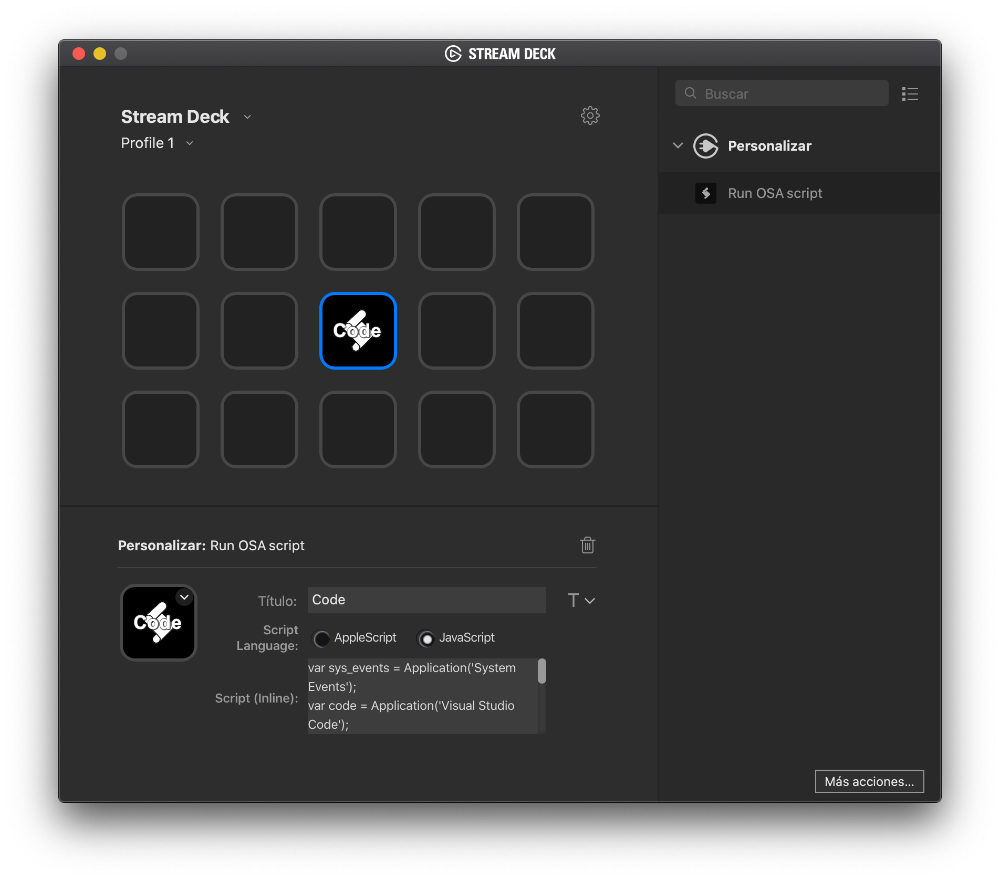

# streamdeck-osascript

Run AppleScript and JavaScript for Automation (JXA) from a Stream Deck key.



**OSA Script** is a macOS-only Stream Deck plugin that runs any OSA script when a key is pressed. It is inspired by the `streamdeck-applescript` plugin, rewritten from scratch in Objective-C for the Stream Deck SDK v2.

## Features

- Runs **AppleScript** or **JXA** (JavaScript for Automation) on key press
- Scripts are written inline in the Property Inspector, one per key
- Native Objective-C plugin using `OSAKit`, so there is no `osascript` subprocess

## Requirements

- macOS 10.13 or later
- Stream Deck software 4.1 or later

## Installation

1. Download `com.gabrielperales.osascript.streamDeckPlugin` from the [latest release](https://github.com/gabrielperales/streamdeck-osascript/releases/latest).
2. Double-click it. The Stream Deck app installs the plugin.
3. Drag the **Run OSA script** action (category **OSA Script**) onto a key.

## Usage

1. Select the key to open its Property Inspector.
2. Pick the **Script Language**: `AppleScript` or `JavaScript`.
3. Paste your script into **Script (Inline)**. It is saved as you type.
4. Press the key.

> [!NOTE]
> The plugin reads a key's script when the key appears on the Stream Deck. After editing a script, switch to another page or profile and back (or restart the Stream Deck app) before pressing the key.

The first time a script controls another app, macOS asks for permission. You can review it later under **System Settings → Privacy & Security → Automation** (and **Accessibility** for scripts that use `System Events` to click or type).

## Examples

### Open VS Code (JXA)

```javascript
var code = Application('Visual Studio Code');
code.activate();
```

### Toggle Dark Mode (AppleScript)

```applescript
tell application "System Events"
	tell appearance preferences
		set dark mode to not dark mode
	end tell
end tell
```

### Play/pause Music (AppleScript)

```applescript
tell application "Music" to playpause
```

### Show a notification (JXA)

```javascript
var app = Application.currentApplication();
app.includeStandardAdditions = true;
app.displayNotification('Hello from Stream Deck', { withTitle: 'OSA Script' });
```

## Troubleshooting

- **Nothing happens when I press the key.** Test the script in Script Editor (or with `osascript` in Terminal) first. Script errors are written to the macOS log; open Console.app and filter by `OSAScript`.
- **My edits are ignored.** See the note in [Usage](#usage): the key has to reappear before the new script is picked up.
- **"Not authorized to send Apple events".** Grant permission under **Privacy & Security → Automation**.

## Building from source

The plugin source lives in [`Sources/`](Sources/):

| Path | Contents |
| --- | --- |
| `Sources/OSAScript.xcodeproj` | Xcode project (scheme `RunOSAScript`) |
| `Sources/MyStreamDeckPlugin.m` | Plugin logic: stores settings per key and runs the script on key down |
| `Sources/Common/` | Elgato SDK connection boilerplate |
| `Sources/Vendor/SocketRocket/` | Vendored WebSocket library |
| `Sources/com.gabrielperales.osascript.sdPlugin/` | Plugin bundle: `manifest.json`, Property Inspector (`index.html`) and icons. The `OSAScript` binary is added at build time |

To build and package (requires Xcode and Node.js 20+):

```sh
make test      # unit tests (Command Line Tools are enough)
make package   # tests, universal binary, `streamdeck validate`, `streamdeck pack`
```

`make package` stops at the first failing step: tests, build, or Elgato's validation. The package is written to `build/release/com.gabrielperales.osascript.streamDeckPlugin`.

GitHub Actions runs the **Build** workflow (`.github/workflows/build.yml`) on pull requests, pushes to `master` and `v*` tags. It calls the reusable **Tests** workflow (`.github/workflows/test.yml`) first, then builds, validates and packages only if the tests pass, and uploads the package as a workflow artifact. To publish a release, bump `Version` in `manifest.json`, add a matching section to [`CHANGELOG.md`](CHANGELOG.md) (it becomes the release notes), then push a matching tag (for example `v1.1.0`); the workflow attaches the package to a GitHub release.

## Resources to learn AppleScript and JXA

- [JXA-Cookbook](https://github.com/JXA-Cookbook/JXA-Cookbook)
- [Automating macOS with JXA (presentation)](https://github.com/josh-/automating-macOS-with-JXA-presentation)
- [Mac Automation Scripting Guide](https://developer.apple.com/library/archive/documentation/LanguagesUtilities/Conceptual/MacAutomationScriptingGuide/)
- [Stack Overflow: JXA](https://stackoverflow.com/questions/tagged/javascript-automation)
- [Stack Overflow: AppleScript](https://stackoverflow.com/questions/tagged/applescript)

## License

[MIT](LICENSE)
